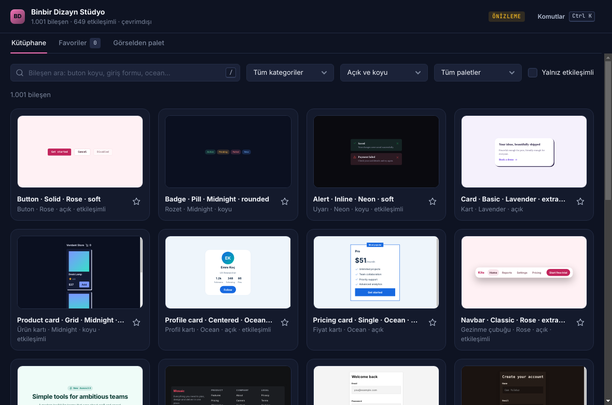
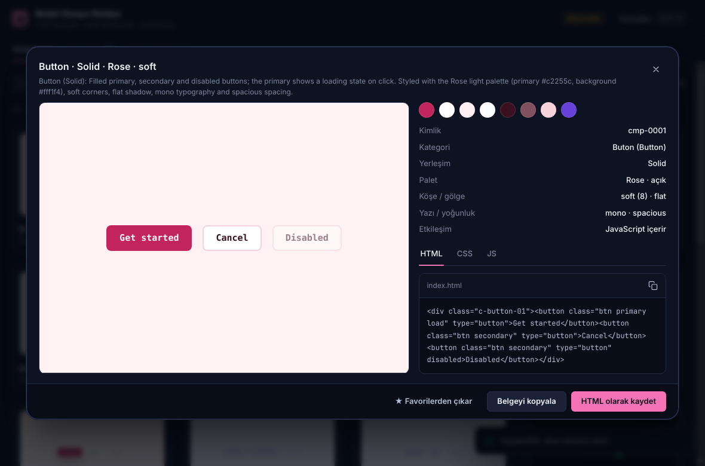
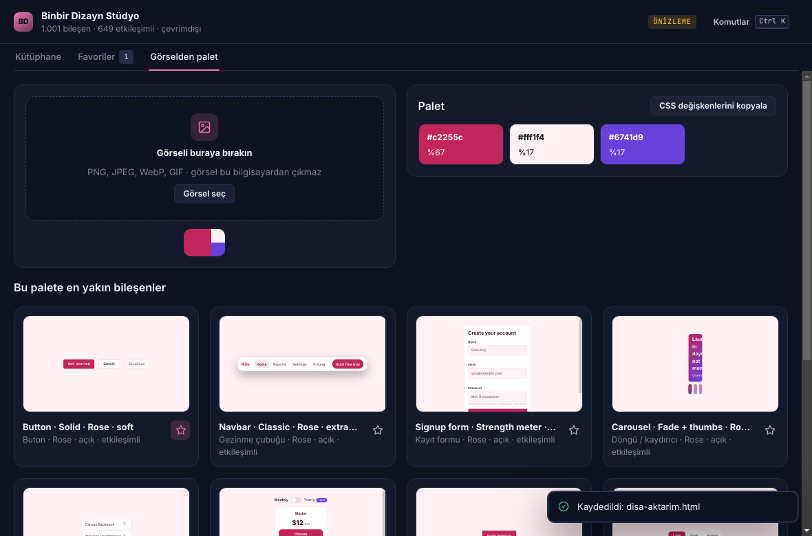
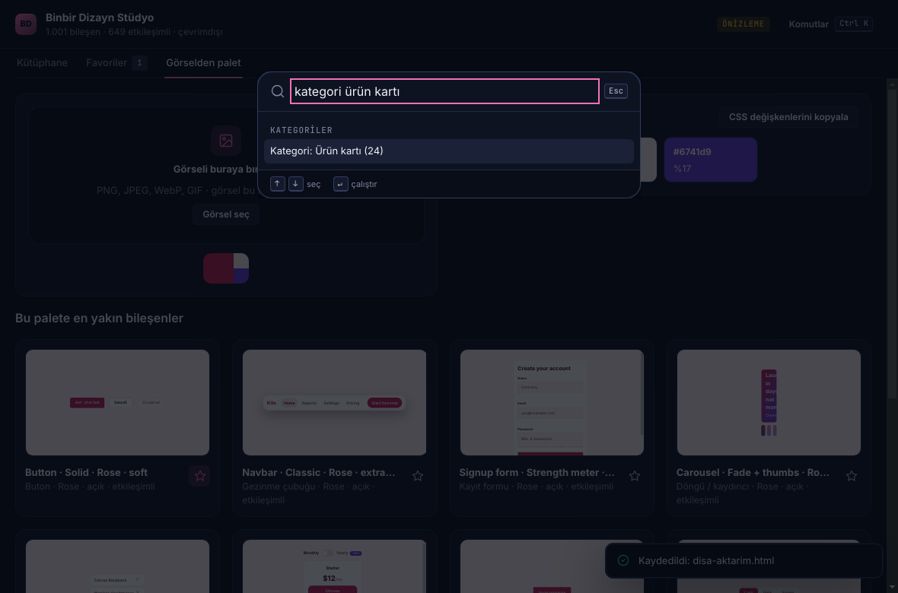

# Binbir Dizayn Stüdyo — Windows uygulaması (PL-010)

PL-010 · 1001 Designs / Pin to Component ürününün **ilk Windows sürümü**. Design Replicator eklentisindeki 1001 bileşenlik referans setini (`design-replicator/dataset/`) **çevrimdışı** gezmek, canlı denemek ve kendi projenize almak içindir. PluginLabs Tasarım Sistemi ile yapılmıştır (koyu tema, Design Replicator aksanı).

Durum: **0.1.0 · önizleme** (imzasız). Release etiketi `studyo-v0.1.0` (eklentinin `design-replicator-v…` etiketlerinden ayrıdır).

| Kütüphane | Ayrıntı ve kod |
|---|---|
|  |  |
| **Görselden palet** | **Komut paleti (Ctrl+K)** |
|  |  |

Görüntüler otomatik duman testinde gerçek Electron penceresinden (Linux, xvfb) alınmıştır; Windows runner'ında alınanlar release'e `windows-*.png` olarak eklenir.

## Yapabilir
- **Kütüphane:** 1001 bileşen, 42 kategori (Türkçe adlarıyla), 14 palet; Türkçe karakter ve büyük/küçük harf duyarsız, çok sözcüklü arama ("buton koyu", "giriş formu"); kategori, açık/koyu, palet ve "yalnız etkileşimli" süzgeçleri. Kartlar canlı küçük önizlemedir.
- **Ayrıntı:** büyük, etkileşimli canlı önizleme; tasarım belirteci renkleri (tıkla → kopyala); HTML / CSS / JS kodu ve kopyalama; **tek dosya HTML olarak kaydet** ya da belgeyi panoya kopyala.
- **Favoriler:** ☆ ile işaretlenen bileşenler ayrı sekmede; `%APPDATA%\Binbir Dizayn Stüdyo\store.json` içinde saklanır (atomik yazma + yedek).
- **Görselden palet:** görseli bırakın/seçin → baskın renkler (yüzdeleriyle), CSS değişkeni olarak kopyalama ve **bu palete en yakın 12 bileşen**. Görsel bilgisayardan çıkmaz.
- **Komut paleti (Ctrl+K)** ve `/` ile aramaya odaklanma.

## Yapamaz (dürüst durum)
- Eklentinin **yapay zekâ modları** (pin/görsel → HTML, AI ile yeniden yazma), **sekme klonlama**, Pro uyarlama ve Monaco editörü masaüstünde **yoktur**; bunlar Chrome eklentisinde kalır.
- Veri seti deterministik olarak üretilmiştir (42 kategori × yerleşim × palet × belirteç); 1001 bağımsız tasarım değildir (bkz. `design-replicator/dataset/README.md`). Lisans: MIT.
- Planın kabul ölçütü ("ilk 10 yetkili referansta düzenlenebilir çıktı ≥%80") bu sürümle **ölçülmedi**; bu sürüm referans kütüphanesinin masaüstü kabuğudur.
- Gerçek bir Windows masaüstünde elle test, DPI (%125/%150/%200), ekran okuyucu ve SmartScreen davranışı denenmedi. Paketler Authenticode ile imzalı değildir.

## Güvenlik
- Ağ yoktur: http/https/ws istekleri oturum düzeyinde iptal edilir, CSP `connect-src 'none'`.
- Ana pencere: `contextIsolation`, `sandbox` açık, `nodeIntegration` kapalı; sayfaya yalnız `window.bdDesktop` (kütüphane, pano yazma, HTML kaydetme, depolama) açılır; her IPC çağrısı ana çerçeve kimliğiyle doğrulanır; gezinme ve yeni pencere kilitli; hiçbir izin verilmez.
- Bileşen önizlemeleri `sandbox="allow-scripts"` iframe'inde (opak köken) çalışır: ana sayfaya, köprüye ve ağa erişemez (duman testi bunu doğrular).
- Veri seti ana süreçte güvenilmeyen girdi gibi doğrulanır (kimlik/kategori biçimi, kod boyutu ≤200 KB, renkler hex); geçersiz girdiler sayılarak atlanır. Dışa aktarılan belgede `</style>`/`</script>` kaçırılır.

## Geliştirme
```bash
npm ci
npm test                                                                       # birim testleri
PLAYWRIGHT_MODULE=playwright xvfb-run -a node tests/desktop-smoke.cjs docs/screenshots   # gerçek Electron penceresi
npm start                                                                      # uygulamayı aç
npm run build:win                                                              # Windows kurulum + taşınabilir exe
```
Windows paketi `.github/workflows/studyo-windows.yml` ile Windows runner'ında derlenir, testlerden geçer, SHA256 ve BUILD-INFO üretilir; `publish=true` ile `studyo-v<sürüm>` release'ine yüklenir.

Kod yerleşimi: `desktop/` (Electron ana süreç, preload, depolama) · `studio-desktop/` (arayüz, `pl/` tasarım sistemi kopyası — elle düzenlenmez) · `tests/`. Renk/boşluk/köşe değerleri yalnız `var(--pl-…)`; `app.css` yalnız yerleşimdir.
